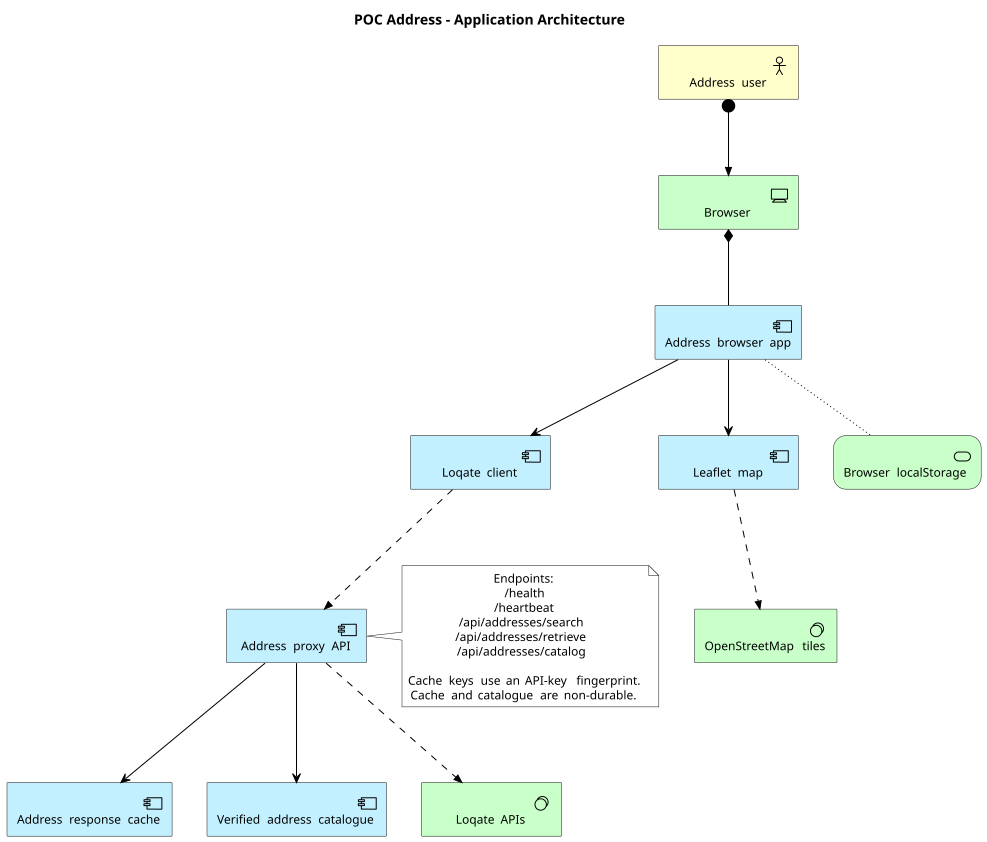

# Address application architecture

The Address POC is a browser-native static application with an optional FastAPI
proxy. The canonical architecture diagram is
[`architecture.puml`](./architecture.puml) and uses the PlantUML ArchiMate
library.

## Current architecture

- The browser hosts the user interface, address search, result selection, detail
  rendering, and Leaflet map.
- `loqate-client.js` calls the Address proxy for search, verification, and the
  verified-address catalogue.
- The FastAPI proxy calls Loqate Find and Verify, caches successful search and
  retrieve responses in process memory, and stores successfully verified
  addresses in a process-local catalogue.
- Cache entries are isolated by an API-key fingerprint and expire according to
  the configured TTL. Neither the cache nor catalogue is durable.
- Browser `localStorage` stores the Loqate API key and theme preference; it is not
  a production secret store.
- Leaflet requests map tiles from OpenStreetMap.

## Runtime boundaries

The static browser app can run without the proxy using its built-in sample
responses. Live Loqate search, verification, and catalogue retrieval require the
FastAPI proxy and a caller-supplied Loqate API key. The proxy does not persist
user accounts or address records.
