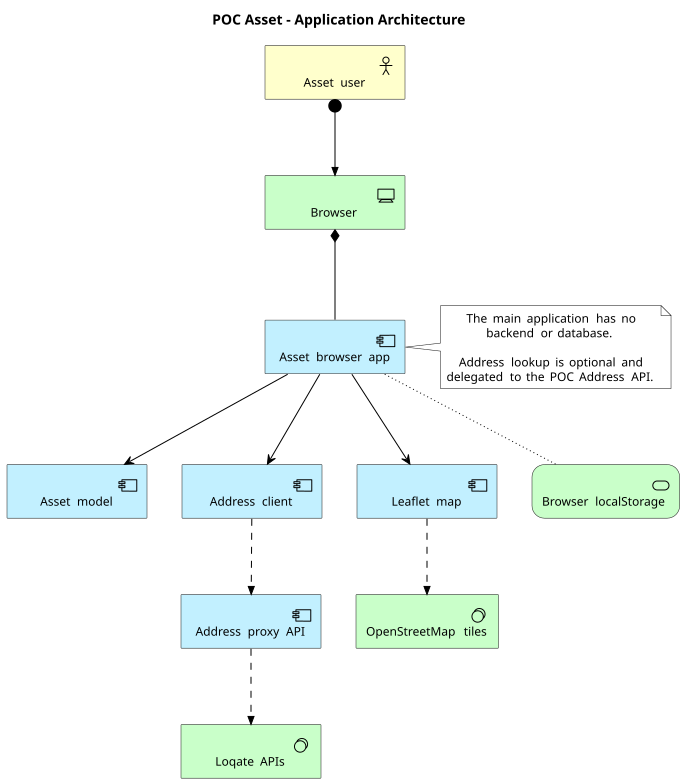

# Asset application architecture

The Asset POC is a browser-native static catalogue with optional address
lookup through the POC Address API. The canonical architecture diagram is
[`architecture.puml`](./architecture.puml) and uses the PlantUML ArchiMate
library.

## Current architecture

- The browser hosts the catalogue, filters, detail panel, create/edit dialog,
  local validation, relationship derivation, and Leaflet map.
- `assets.js` contains fictional fixtures, validation, search helpers, and
  derived Unit relationships; `app.js` manages rendering and browser state.
- `localStorage` stores Asset records and theme preference. There is no Asset
  backend, database, authentication, or multi-user persistence.
- Optional address lookup uses the POC Address client and proxy, which then
  delegates live search and verification to Loqate.
- Leaflet requests map tiles from OpenStreetMap.

## Runtime boundaries

The Asset app works as a static page with fictional data and no service
dependency for its core catalogue flow. Live address lookup requires the
configured POC Address API and a caller-supplied Loqate API key.
