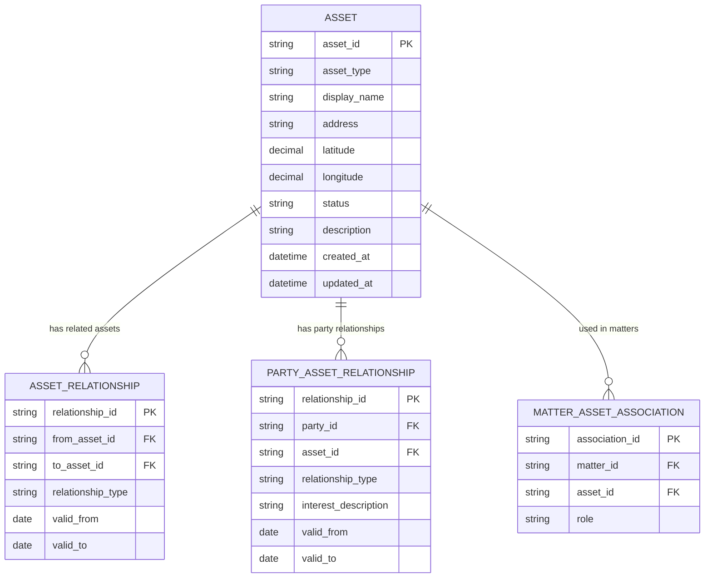

# Asset — Product Requirements Document

Status: draft for review. Owner: Solution Architecture. Date: 2026-11-03.

## Summary

Asset is a reusable record for a real-estate subject: land, an estate, a building, or
a separately managed part of a building such as a house, apartment, office, or factory.
An estate is a collection of land and buildings within a defined boundary. Assets can
be related to describe how a larger property is composed, while each asset remains
independently identifiable and reusable.

The product provides a consistent way for business processes to find, create,
reference, and maintain real-estate records. It separates the identity and physical
description of an asset from the parties, legal interests, matters, transactions,
valuations, and work associated with it.

## Problem

Property information is often captured differently in each transaction or business
system. The same property can be duplicated under different addresses or descriptions,
and a property record may ambiguously refer to a parcel, a building, a unit, or an
entire estate. This makes it difficult to reuse data, understand what is included in
a transaction, and maintain a reliable history.

The existing WIP model allows a WIP record to refer to a property, but a shared Asset
definition is needed to clarify what that property represents and how it relates to
other records.

## Goals

- Represent real-estate assets consistently across business processes.
- Support land, sites/estates, buildings, and separately managed units.
- Distinguish a property as a whole from its parcels, buildings, and units.
- Give each asset a stable identifier and support external identifiers where available.
- Reuse assets across instructions, matters, transactions, and reporting periods.
- Record location and descriptive details without treating them as proof of legal title.
- Preserve changes to asset details and relationships so historical records remain
  interpretable.

## Non-goals

- Replacing a land registry, cadastral system, property-management system, or GIS.
- Establishing legal title, tenure, ownership, boundaries, or rights from descriptive
  data alone.
- Managing the full lifecycle of a property transaction, instruction, or work-in-
  progress record.
- Providing property valuation, pricing, investment advice, planning decisions, or
  legal advice.
- Treating addresses as globally unique asset identifiers.
- Requiring a single taxonomy to encode every country's legal property concepts.

## Users and responsibilities

| User | Need |
|---|---|
| Case handler / adviser | Find or create the correct property and attach it to a matter or instruction. |
| Operations | Correct descriptions, identifiers, and component relationships with history. |
| Property or asset specialist | Understand the physical subject and the scope of a property record. |
| Integrating systems | Reference an Asset consistently without creating a local duplicate. |
| Administrator / data steward | Manage data quality, access, and source provenance. |

## Core concepts

| Concept | Meaning |
|---|---|
| **Asset** | A real-estate subject with a stable identifier, type, status, and descriptive details. |
| **Land parcel** | A geographically defined area of land. A parcel may exist without a building and may be linked to registry or cadastral identifiers. |
| **Estate** | A collection of land and buildings within a defined boundary. The estate is an asset in its own right and may be composed of separately identifiable land parcels and buildings. Its defined boundary describes the estate's scope; it does not, by itself, prove legal title, cadastral boundaries, or ownership. |
| **Site** | A location or operational grouping that may contain parcels, buildings, and units. A site is not necessarily an estate; use the estate classification when the defined-boundary collection is intended. |
| **Building** | A physical structure, such as a house, apartment building, office, or factory. |
| **Unit** | A separately identifiable or managed part of a building, such as an apartment, commercial area, or suite. A Unit records its enclosing Building; the Building exposes the related Units through the inverse of that same relationship. |
| **Asset relationship** | A typed relationship between assets, such as `part_of`, `located_on`, or `associated_with`, optionally effective-dated. It does not by itself establish title or legal boundaries. |
| **Party relationship** | A separately recorded relationship between an Asset and a Party, such as an ownership interest, lease, or management relationship. The relationship type and its evidence are explicit. |
| **Matter association** | A link from an Asset to a matter, instruction, or transaction with a context-specific role. It does not change the Asset's identity. |

An apartment or commercial area within a building is recorded as a Unit and linked to
its enclosing Building. The Building's list of Units is the inverse view of those
links, not a separately maintained relationship. An estate has a defined boundary and
may include multiple land parcels and buildings. The record should make its type,
boundary representation, and known relationships clear.

## Conceptual model

This is a conceptual model, not a physical schema. Asset classifications, property
details, external identifiers, and geospatial data may be represented in related
records, provided that asset identity and relationship semantics remain explicit.

## User journeys

### Find or create an Asset

1. A user or integrating system searches by known identifiers, address, name, or
   descriptive details.
2. The system returns possible matches with their asset type and distinguishing
   information, subject to access permissions.
3. The caller selects an existing Asset or creates one with a type and the minimum
   available details.
4. The system assigns a stable identifier and records the source and creation event.

An uncertain match is presented for review; the system does not silently merge assets.

### Describe a larger property

1. The user identifies the relevant assets, such as a site, land parcel, building,
   and apartment unit.
2. The user records explicit relationships between those assets.
3. The user identifies whether each relationship is confirmed, reported, or
   unverified when source confidence is relevant.
4. A matter can reference the appropriate level of asset without assuming that all
   related components are included.

### Associate a Party or matter

1. The user links a Party to an Asset with an explicit relationship type, or links the
   Asset to a matter with a context-specific role.
2. Where applicable, the relationship includes effective dates, source, and evidence.
3. Ending or correcting the relationship preserves its history and does not delete
   either the Party or the Asset.

## Functional requirements

Priority: **Must** (required for MVP), **Should** (important but deferrable),
**Could** (future enhancement).

### Asset identity and lifecycle

| ID | Pri | Requirement |
|---|---|---|
| AST-1 | Must | Every Asset has a stable, unique identifier, an explicit asset type, an address, a geolocation, a display name or description, and a record status. |
| AST-2 | Must | The system supports at least land parcel, site, estate, building, and unit classifications. |
| AST-3 | Must | Asset type is not inferred solely from its address or matter role. |
| AST-4 | Must | An Asset can be created, retrieved, searched, and updated by authorized users or systems. |
| AST-5 | Must | Asset identity is independent from any Party, matter, instruction, transaction, or WIP record that references it. |
| AST-6 | Must | A Party or matter can reference an Asset by its stable identifier. |
| AST-7 | Must | An Asset can be marked inactive or archived without deleting historical references. Record status is distinct from planning, occupancy, ownership, or legal status. |
| AST-8 | Must | Updates to an Asset do not silently rewrite previously recorded transaction or matter evidence. |
| AST-9 | Should | Search supports identifiers, address/location, name/description, type, and status filters. |
| AST-10 | Should | The system surfaces potential duplicates for review without automatically merging them. |
| AST-11 | Must | An estate has a defined boundary represented by spatial geometry or a reference to an authoritative or recorded boundary definition, with source and capture date where known. |
| AST-12 | Must | The estate boundary defines the scope of the estate record and must not be presented as proof of legal title, ownership, or cadastral parcel boundaries. |

### Property details and location

| ID | Pri | Requirement |
|---|---|---|
| DET-1 | Must | An Asset can hold a human-readable name and description in addition to its stable identifier. |
| DET-2 | Must | Every Asset has an address describing its physical location. Store it as structured address fields where available; where no formal street address exists, capture an appropriate site/land description and country rather than inventing an address. |
| DET-3 | Must | Every Asset has a geolocation. Store latitude and longitude with a declared coordinate reference system, source, capture date, and known precision or confidence. |
| DET-4 | Must | External identifiers record their type, issuer or jurisdiction, value, and source where known. |
| DET-5 | Should | The model supports separate postal, site, registered, or other address purposes where relevant, while identifying the primary physical address. |
| DET-6 | Should | The model can store area or measurement values with an explicit quantity type and unit; conversion or aggregation must not discard the original unit or source. |
| DET-7 | Must | Where an estate boundary is stored as geometry, record its coordinate reference system, source, capture date, and known precision or confidence. |
| DET-8 | Could | Store geospatial boundaries for non-estate assets with a declared coordinate reference system, precision, source, and confidence. |

### Asset composition and relationships

| ID | Pri | Requirement |
|---|---|---|
| REL-1 | Must | The system can link assets using an explicit relationship type, such as `part_of`, `located_on`, or `associated_with`. |
| REL-2 | Must | An Asset can have multiple related assets; the model must not assume every property is a simple single-parent tree. |
| REL-3 | Must | Asset relationships can be ended without deleting their history. |
| REL-4 | Must | Self-referential relationships and duplicate active links of the same type are rejected. |
| REL-5 | Must | Relationship semantics do not imply legal ownership, title, boundary, or inclusion in a transaction unless explicitly represented and evidenced. |
| REL-6 | Should | Users can navigate from an Asset to its related parcels, sites, buildings, and units, and inspect relationship dates and provenance. |
| REL-7 | Could | Support complex shared boundaries, easements, and spatial intersections as explicit domain relationships or geometry, after requirements are agreed. |
| REL-8 | Must | An apartment or commercial area modeled as a Unit must reference its enclosing Building through an explicit `part_of` relationship. For the effective period of that relationship, a Unit has one enclosing Building. |
| REL-9 | Must | A Building exposes its Units by querying the inverse of the Unit-to-Building `part_of` relationship; the inverse must not be stored or edited as a separate link. |
| REL-10 | Must | A Unit-to-Building relationship can be created, changed, or ended with validation and an audit event; changing the enclosing Building preserves the former relationship's history. |

### Parties, matters, and evidence

| ID | Pri | Requirement |
|---|---|---|
| ASSOC-1 | Must | A Party-to-Asset relationship has an explicit type and does not make the Party's relationship intrinsic or permanent. |
| ASSOC-2 | Must | Ownership, leasehold, occupation, management, and other interests are distinct relationship types and must not be inferred from one another. |
| ASSOC-3 | Must | A relationship may carry effective dates, source, and references to supporting evidence where applicable. |
| ASSOC-4 | Must | Matter-specific roles, such as purchaser or seller, are recorded on the matter association, not on the Asset identity. |
| ASSOC-5 | Must | The system does not assert legal title or ownership from an unverified user-entered association. |
| ASSOC-6 | Should | A matter or instruction can reference multiple Assets and identify which one is primary, where the consuming process needs that distinction. |

### Data quality, security, and audit

| ID | Pri | Requirement |
|---|---|---|
| GOV-1 | Must | Every create, update, archive, and relationship change records actor, time, affected Asset, and change details. |
| GOV-2 | Must | Where Asset details or relationships come from an external source, the source and capture time can be recorded. |
| GOV-3 | Must | Access to non-public property or transaction information is authorized and auditable. |
| GOV-4 | Must | Invalid asset types, malformed relationships, and unauthorized access return explicit errors. |
| GOV-5 | Must | Asset data is retained, corrected, or anonymized according to the applicable records and data-protection policy. |
| GOV-6 | Should | Data quality rules identify missing or conflicting key identifiers without treating absence as proof that an Asset is invalid. |

## Data principles

- An Asset record identifies the subject; it is not the transaction, instruction, or
  financial WIP line.
- A property description may refer to a parcel, site, building, unit, or combination.
  The selected type and relationships must make that scope visible.
- An estate is a defined-boundary collection of land and buildings; its boundary is
  distinct from legal title and cadastral parcel boundaries.
- An apartment or commercial Unit belongs to one enclosing Building at a time; the
  Building's related-Units view is derived from the Unit's `part_of` relationship.
- An address is a location descriptor, not a unique identifier or proof of a boundary.
- Every Asset has both an address (or a suitable site/land location description where
  no formal address exists) and a geolocation. The geolocation is a point identifying
  the Asset's location; an estate boundary is separate spatial data.
- A larger property may contain multiple parcels or buildings; a unit may relate to a
  building without the relationship proving legal subdivision.
- Asset composition is not necessarily a tree. The model must allow relationships
  without assuming exclusive parentage.
- Ownership, tenure, occupation, management, and transaction roles are separate
  concepts and require explicit relationship types.
- External identifiers and sourced facts retain their issuer, source, and provenance.
- Do not infer legal or physical facts from names, addresses, or informal descriptions.

## Success measures

| Measure | Target |
|---|---|
| Assets created with a stable identifier and explicit type | 100% |
| Matter or WIP references resolve to an Asset identifier | 100% |
| Asset and relationship changes with an attributable audit event | 100% |
| Unreviewed ambiguous Asset matches automatically merged | 0 |
| Historical matter records silently changed by Asset updates | 0 |
| Relationships interpreted as legal title without explicit evidence | 0 |

## MVP scope

The MVP includes:

- Stable Asset identity and explicit types for land parcel, site, estate, building, and
  unit.
- Basic description, address, geolocation, external identifiers, and source metadata.
- A defined boundary for estates, stored as geometry or a reference to a boundary
  definition, with provenance where known.
- Search, retrieval, creation, and authorized update.
- Explicit relationships between Asset records, including component relationships.
- References from matters/instructions and typed Party-to-Asset associations.
- Audit history, authorization, inactive/archive status, and validation.

The MVP does not require detailed GIS boundaries, automated registry integration,
valuation, title verification, legal analysis, or a comprehensive international
property taxonomy.

## Dependencies and open questions

1. **Boundary representation:** Which geometry format, coordinate reference systems,
   and authoritative boundary sources should be supported in the initial jurisdictions?
2. **Asset identity granularity:** When should an apartment or other unit be its own
   Asset versus a detail of its building?
3. **Primary identifiers:** Which land registry, cadastral, local-authority, or
   internal identifiers are required in each launch jurisdiction?
4. **Address and location:** Which address standards, country codes, coordinate
   reference systems, and geospatial formats should be supported?
5. **Ownership and interests:** Does the Asset service store Party relationships, or
   should a separate title/interest service own them and expose references?
6. **Evidence and provenance:** Which sources are trusted for property attributes and
   relationships, and how should conflicting sources be resolved?
7. **Valuation and financial data:** Should valuation be modeled separately, and which
   system owns valuation history?
8. **Tenancy and retention:** What access, retention, correction, and anonymisation
   rules apply to asset and transaction-linked data?
9. **WIP integration:** Confirm whether the existing WIP `propertyId` reference should
   point directly to the canonical Asset identifier or to an adapter/mapping.

## Acceptance criteria

- A user can create and retrieve an Asset of type land parcel, site, estate, building,
  or unit.
- An apartment or commercial Unit references exactly one enclosing Building for its
  active relationship period, and retrieving the Building shows that Unit through the
  inverse relationship.
- Every Asset has an address or appropriate land/site location description and a
  geolocation; both are stored with available provenance and precision information.
- An estate is recorded as a collection of land and buildings with a defined boundary;
  that boundary can be inspected with its source and is not represented as proof of
  title or cadastral boundaries.
- A house, apartment, or factory can be represented as a building or unit at the
  appropriate level, without making the address the record identifier.
- A site can be related to multiple parcels and buildings, and a building can be
  related to units, without implying legal ownership or boundaries.
- A matter can reference the relevant Asset by stable identifier and assign a
  matter-specific role without changing the Asset's identity.
- A Party can be associated with an Asset using an explicit, auditable relationship
  type and effective period.
- Ending a relationship preserves its history, source, and attribution.
- Self-links, invalid relationship types, and duplicate active relationships are
  rejected with actionable errors.
- Changes to Asset details do not silently rewrite historic matter or transaction
  records.
- Users can distinguish sourced or confirmed data from unverified descriptions where
  provenance is available.
