# Instruction database structure

This document describes the conceptual relational structure represented by
[`instruction-types.md`](instruction-types.md). It uses the neutral `poc_`
prefix so the public documentation is not tied to a particular organisation or
CRM vendor.

The structure is a shared finance-layer parent with one service-line parent,
zero or one primary property, zero or one primary contact, and many WIP and
portfolio-property records.

## Entity relationship overview

```mermaid
erDiagram
    poc_Account ||--o{ poc_Instruction : "client or legal entity"
    poc_Contact ||--o{ poc_Instruction : "primary contact"
    poc_Property ||--o{ poc_Instruction : "primary property"
    poc_Instruction ||--o{ poc_DealProperty : "portfolio"
    poc_Property ||--o{ poc_DealProperty : "included property"
    poc_Instruction ||--o{ poc_WIP : "finance children"

    poc_Instruction ||--o| poc_Deal : "Capital Markets"
    poc_Instruction ||--o| poc_Engagement : "OSS"
    poc_Instruction ||--o| poc_ValuationInstruction : "Valuations"
    poc_Instruction ||--o| poc_Lease : "Leasing"
    poc_Instruction ||--o| poc_SalesInstruction : "Residential Sales"
    poc_Instruction ||--o| poc_LettingsInstruction : "Residential Lettings"
    poc_Instruction ||--o| poc_PropertyMandate : "Property Management"
    poc_Instruction ||--o| poc_DebtMandate : "Capital Advisory"
    poc_Instruction ||--o| poc_InvestorMandate : "Investor Advisory"
    poc_Instruction ||--o| poc_DevelopmentProject : "Development"
    poc_Instruction ||--o| poc_BuildingSurvey : "Building Consultancy"
    poc_Instruction ||--o| poc_WorkplaceAssessment : "Workplace"
    poc_Instruction ||--o| poc_ESGAssessment : "ESG Consultancy"
```

The diagram shows each specialised table as optional because the actual row is
selected by `poc_serviceline`. The database must enforce the stronger rule:
exactly one service-line parent exists for every `poc_Instruction`.

## Core table: `poc_Instruction`

`poc_Instruction` is the shared finance-layer parent. It is the stable
reference used by WIP, billing, reporting, and integrations.

| Column | Type | Required | Description |
|---|---|---:|---|
| `poc_instructionid` | GUID/UUID | yes | Primary key. |
| `poc_name` | string | yes | Generated human-readable reference, for example `INS-000001`. |
| `poc_instructiontype` | choice | yes | `Mandate`, `Engagement`, or `Instruction`. |
| `poc_serviceline` | choice | yes | Selects the one specialised parent table. |
| `poc_clientaccountid` | foreign key | yes | Brand/Group relationship owner. |
| `poc_legalentityaccountid` | foreign key | conditional | Contracting and invoicing entity. |
| `poc_primarycontactid` | foreign key | no | Main contact for the Instruction. |
| `poc_propertyid` | foreign key | no | Primary property; not the complete portfolio. |
| `poc_owningoffice` | foreign key/choice | yes | Responsible office and security scope. |
| `poc_instructionstatus` | choice | yes | `Active`, `Completed`, `On Hold`, or `Withdrawn`. |
| `poc_startdate` | date | yes | Date work or appointment starts. |
| `poc_signeddate` | date | conditional | Date the instruction or mandate was signed. |
| `poc_enddate` | date | no | Completion or termination date. |
| `poc_expectedrevenue` | decimal | no | Expected revenue in the agreed currency. |
| `poc_terminationreason` | choice/string | conditional | Required when status is `Withdrawn`. |
| `poc_comments` | text | no | Additional matter notes. |
| `poc_fin_localsystemref` | string | no | External finance-system reference. |
| `poc_fin_localsystemname` | choice | no | Source finance system. |
| `poc_fin_projectid` | string | no | Finance project reference. |
| `created_at` | timestamp | yes | Creation timestamp. |
| `updated_at` | timestamp | yes | Last update timestamp. |

The table should also support attributable audit events for changes to status,
client, Legal Entity, service-line parent, dates, and property relationships.

## Shared reference tables

### `poc_Account`

Stores organisations and other accounts referenced by an Instruction.

- `poc_accountid` — primary key.
- `poc_name` — account name.
- `poc_accounttype` — at least `Brand/Group`, `Legal Entity`, or another
  approved account classification.
- Registration and jurisdiction fields where required by the implementation.

`poc_clientaccountid` and `poc_legalentityaccountid` may point to different
rows. A Legal Entity lookup must reject an account with an incompatible
classification.

### `poc_Contact`

Stores people associated with an Instruction or Account.

- `poc_contactid` — primary key.
- Name, email, phone, and account relationship fields.
- Optional role or capacity fields.

### `poc_Property`

Stores the primary property reference.

- `poc_propertyid` — primary key.
- Address and location fields.
- Title, tenure, property type, and sector fields where applicable.

The primary property is a convenience reference. It must not be used to
represent a multi-property portfolio by itself.

## Service-line parent tables

Each table has a primary key that is also a unique foreign key to
`poc_Instruction`. The specialised table carries fields that are meaningful
only to that service line.

| Table | Key specialised fields |
|---|---|
| `poc_Deal` | Transaction type, jurisdictions, transaction parties, deal stage, portfolio context |
| `poc_Engagement` | Advisory scope, occupier/workplace requirements, locations, deliverables |
| `poc_ValuationInstruction` | Instructing account/contact, purpose, basis, inspection/report dates, valuer, reviewer, valuation outputs |
| `poc_Lease` | Landlord/tenant role, lease objective, lease term, rent, break/renewal dates |
| `poc_SalesInstruction` | Vendor account/contact, residential property, sales variant, asking/guide/achieved price, commission, milestones |
| `poc_LettingsInstruction` | Landlord account/contact, residential property, lettings variant, rent, management fee, tenancy dates |
| `poc_PropertyMandate` | Managed property/portfolio, management scope, term, fee basis |
| `poc_DebtMandate` | Borrower, lender, loan amount, debt product, funding purpose, conditions |
| `poc_InvestorMandate` | Investor, strategy, geography, asset class, sourcing/reporting scope |
| `poc_DevelopmentProject` | Development site, feasibility/planning scope, programme milestones |
| `poc_BuildingSurvey` | Survey or consultancy scope, inspection, report deadline, assumptions |
| `poc_WorkplaceAssessment` | Sites, utilisation/design/change scope, outputs and milestones |
| `poc_ESGAssessment` | Property/portfolio, energy or ESG scope, reporting boundary, targets and certification |

The service-line table must not duplicate the shared client, Legal Entity,
office, status, or Instruction identity unless a deliberate snapshot is
required for historical reporting.

## Portfolio junction: `poc_DealProperty`

`poc_DealProperty` represents the complete property portfolio for an
Instruction.

| Column | Type | Required | Description |
|---|---|---:|---|
| `poc_dealpropertyid` | GUID/UUID | yes | Primary key. |
| `poc_instructionid` | foreign key | yes | Related Instruction. |
| `poc_propertyid` | foreign key | yes | Related property. |
| `poc_relationshipstatus` | choice | yes | Active, Ended, or another approved value. |
| `poc_startdate` | date | no | Date included in the portfolio. |
| `poc_enddate` | date | no | Date removed from the portfolio. |
| `poc_role` | choice/string | no | Primary, secondary, subject, or another approved role. |

Recommended constraints:

- No duplicate active Instruction/property relationship.
- `poc_enddate` cannot precede `poc_startdate`.
- Historical rows are ended, not silently deleted.

## WIP child table: `poc_WIP`

`poc_WIP` has a many-to-one relationship to `poc_Instruction`.

| Column | Type | Required | Description |
|---|---|---:|---|
| `poc_wipid` | GUID/UUID | yes | Primary key. |
| `poc_instructionid` | foreign key | yes | Parent Instruction. |
| `poc_amount` | decimal | according to WIP schema | WIP value or amount. |
| `poc_currency` | choice | according to WIP schema | Currency for the amount. |
| `poc_period` | date/period | according to WIP schema | Accounting or reporting period. |
| `poc_status` | choice | according to WIP schema | WIP lifecycle state. |

WIP must obtain service-line context through `poc_Instruction`; it should not
carry one direct foreign key for every service-line table. The exact rule for
creating WIP from Active or signed Instructions remains a business decision.

## Integrity rules

1. `poc_instructionid` and `poc_name` are unique.
2. `poc_instructiontype`, `poc_serviceline`, status, and owning office are
   required.
3. Exactly one service-line parent foreign key is populated.
4. The populated parent must match `poc_serviceline`.
5. A Withdrawn Instruction requires `poc_terminationreason`.
6. End dates cannot precede start dates.
7. A Legal Entity foreign key must reference a Legal Entity account.
8. Portfolio relationships are historical and cannot have duplicate active
   pairs.
9. WIP rows must reference an existing Instruction.
10. Updates to identity, parent relationships, status, and financial references
    are auditable.

## Implementation boundary

This is a logical public model, not a final SQL, Dataverse, or API schema.
Physical column types, option-set values, indexes, row-level permissions,
audit implementation, and migration rules require approval before production
implementation.
