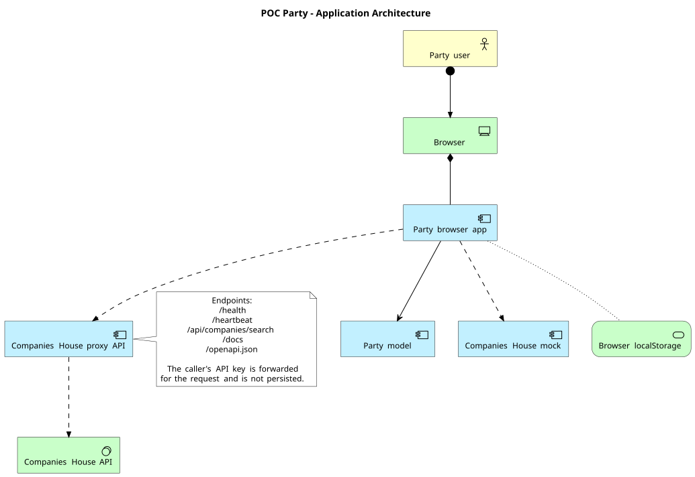

# Party application architecture

The Party POC is a browser-native static Party catalogue with an optional
Companies House proxy. The canonical architecture diagram is
[`architecture.puml`](./architecture.puml) and uses the PlantUML ArchiMate
library.

## Current architecture

- The browser hosts the Party catalogue, search and filters, detail panel,
  create/edit dialog, membership and matter-reference views, and local
  validation.
- `party.js` contains the Party model, fictional fixtures, validation, and
  search helpers; `app.js` manages rendering and browser state.
- `localStorage` stores Party records and theme preference. There is no
  production database, authentication, authorization, or server-side audit.
- The built-in `zoomalong limited` query returns a local mock response without
  network access or an API key.
- Other company searches can use the optional FastAPI proxy. The proxy forwards
  the caller's key to Companies House with Basic authentication and does not
  persist it. Direct browser lookup is also supported when no proxy URL is
  configured.

## Runtime boundaries

The core Party catalogue works as a static page with fictional data. Live
Companies House lookup requires network access and a caller-supplied API key;
selecting a result is not legal verification.
