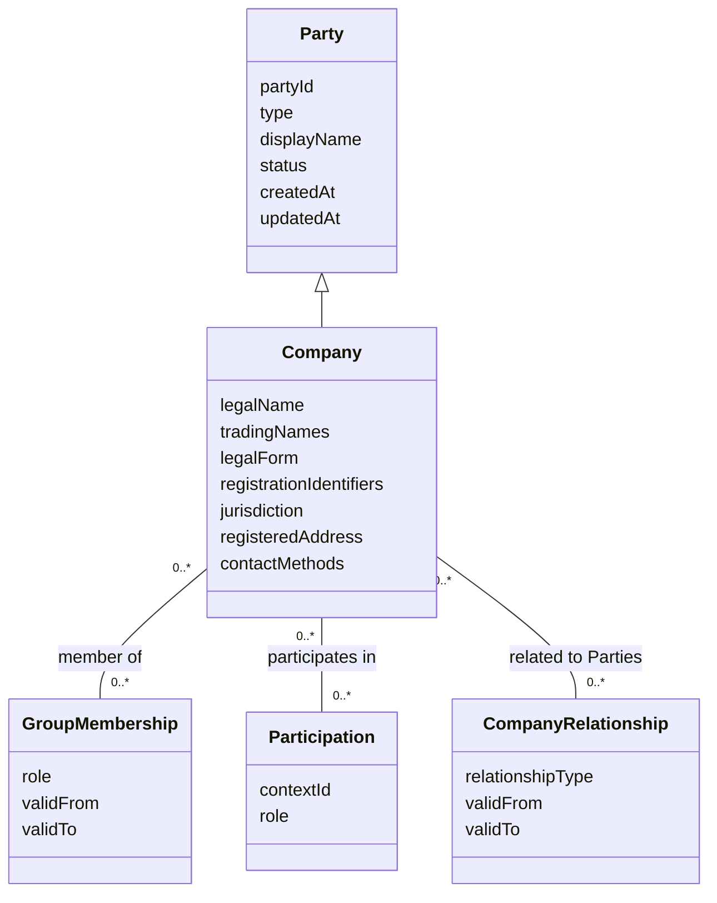

# Company Party — Domain Model

Status: draft for review. Owner: Solution Architecture. Date: 2026-11-03.

## Definition

A **Company** is an organization represented as a Party. It has a stable Party
identifier and identity details describing the organization. Depending on the
jurisdiction and business context, it may be a registered legal entity or another
recognized organizational form.

A Company record describes **which organization this is**. It does not, by itself,
describe the organization's role in a matter, its owners or controllers, an
individual's authority to act for it, or the outcome of a company verification or
compliance check. Those facts belong to separately modeled relationships or processes.

## Relationship to Party



This is a conceptual model. `Company` may be implemented as a Party subtype or as
type-specific details associated with a Party record. There must be one stable Party
identity either way.

## Attributes

| Attribute | Requiredness | Description |
|---|---|---|
| `partyId` | Required | Stable identifier for this organization as a Party. Generated by the Party service; not derived from its name or registration number. |
| `type` | Required | Always `company`. It cannot be changed in place to `individual` or `group`. |
| `displayName` | Required | Human-readable name used in lists and references. May use the legal name or an appropriate trading name. |
| `legalName` | Conditional | Name under which the organization is legally constituted or registered, where applicable. |
| `tradingNames` | Optional, repeatable | Current or former business names, with source and effective dates where known. A trading name is not a separate Company unless independently represented as one. |
| `legalForm` | Optional, jurisdiction-dependent | Organizational or legal form, using a defined code set where a consuming process requires it. |
| `registrationIdentifiers` | Optional, repeatable and sensitive | Registration number or other official identifier, including identifier type, issuing jurisdiction/authority, and relevant dates. Values are not assumed globally unique. |
| `jurisdiction` | Conditional | Country or jurisdiction of formation or registration, represented with the agreed code standard. Do not infer this from an address. |
| `registeredAddress` | Optional, purpose-dependent | Registered office or official address, where applicable, with effective dates and source where required. |
| `businessAddresses` | Optional, repeatable | Operating or correspondence addresses, distinguished by purpose and effective dates. Do not assume an address is a registered office. |
| `contactMethods` | Optional, repeatable | Organization contact methods, with type, value, preferred indicator, and verification state where applicable. |
| `taxIdentifiers` | Optional, repeatable and highly sensitive | Tax identifiers, each scoped by type and issuing jurisdiction. Collect and expose only for an approved purpose. |
| `status` | Required | Party-record status, such as `active` or `inactive`. This is distinct from legal standing, dissolution, or insolvency status. |
| `createdAt`, `updatedAt` | Required | Record creation and most recent update timestamps. |

Fields marked conditional or optional are not universally required to create a
Company. A consuming process defines the attributes it needs and validates them
before that process proceeds. Avoid storing empty placeholders or collecting
identifiers “just in case.”

## Related relationships

### Group membership

A Company can be a member of zero or more groups. Membership is a separate,
effective-dated relationship and may include a group-specific role, such as
`corporate purchaser` or `subsidiary`. Group membership alone does not establish
ownership, control, or legal authority.

### Matter or process participation

A Company can participate in zero or more matters or processes. The participation
relationship carries the context-specific role, such as `seller`, `borrower`, or
`counterparty`. A Company's role in one matter must not be copied onto its Party
identity or assumed in another matter.

### Relationships to individuals and other companies

Officers, directors, agents, owners, beneficial owners, parent companies, and
subsidiaries should be represented as explicit, typed relationships when required.
Such relationships may have effective dates, source, and verification evidence. They
must not be inferred solely from shared names, addresses, group membership, or a
free-text note.

The relationship model must distinguish a person's role or authority to act from the
person's own identity. Rules for ownership thresholds, control, and evidence are
defined by the consuming business process or jurisdiction-specific policy.

### Verification and compliance

Company verification results, screening findings, decisions, and evidence are owned
by the relevant process. They reference the Company Party but are not intrinsic
identity attributes. A verification outcome must not silently overwrite the
organization's identity details or legal status.

## Constraints and behavior

- Each Company is one Party with a stable identifier and type `company`.
- Names and addresses are descriptive attributes, not unique keys. Organizations may
  share similar names, change legal or trading names, or use different scripts.
- Registration identifiers are interpreted in the context of their type and issuing
  jurisdiction; they are not assumed globally unique.
- A Company may be represented even when it has no registration identifier, if its
  organizational form or the consuming process permits it.
- Legal form, jurisdiction, legal standing, and Party-record status are distinct
  concepts and must not be conflated.
- Identity corrections and changes to official details are authorized and auditable;
  historical process records remain interpretable.
- Address and contact changes do not rewrite previously recorded process snapshots or
  evidence.
- Inactivation is reversible only through an authorized action and must be audited.
- Sensitive registration and tax identifiers are returned only to callers with the
  appropriate authorization.

## Example

```yaml
partyId: party_01JEXAMPLE
type: company
displayName: "Example Holdings Limited"
status: active
company:
  legalName: "Example Holdings Limited"
  tradingNames: []
  legalForm: null
  jurisdiction: null
  registrationIdentifiers: []
  registeredAddress: null
  businessAddresses: []
  contactMethods: []
  taxIdentifiers: []
```

The example is illustrative, not an API contract. Optional organizational
information is omitted unless a legitimate use case requires it.

## Open decisions

1. Which organizational forms count as a Company Party, including partnerships,
   trusts, charities, public bodies, and unincorporated associations?
2. Which identifier types and jurisdiction code standards are in scope for the first
   consumers?
3. Should names and registered details retain full field-level history, or are
   attributed audit events and process-specific snapshots sufficient?
4. Which sources are authoritative for legal name, registration status, addresses,
   officers, and ownership relationships?
5. Which company relationships are needed in the MVP, and which systems own their
   validation and evidence?
6. What access controls, masking, retention, and anonymisation rules apply to
   registration and tax identifiers?
7. Should Party maintain legal standing (for example, dissolved or in liquidation),
   or should that be a separately sourced and time-stamped status record?

## Relationship to CDD

The current CDD/KYC model uses `Subject` for a person or company. If Company Party
becomes the canonical organization identity record, CDD should reference its Party
identifier and keep journey-specific requirements, evidence, findings, and decisions
on the CDD journey. Company verification and ownership/control evidence should be
linked to the relevant journey and source, not treated as timeless identity facts.
The integration contract must define whether CDD stores a reference only or also a
minimal, time-stamped snapshot needed to interpret historical decisions.
