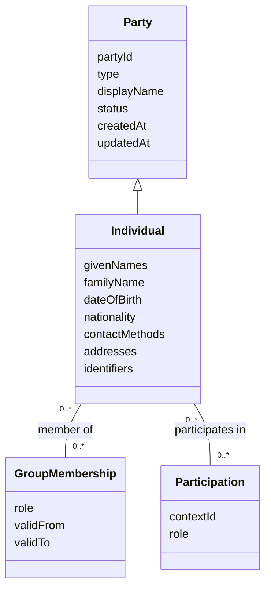

# Individual Party — Domain Model

Status: draft for review. Owner: Solution Architecture. Date: 2026-11-03.

## Definition

An **Individual** is a natural person represented as a Party. The Individual has a
stable Party identifier and identity details that describe the person. The same
Individual may participate in multiple matters and may be a member of multiple groups.

An Individual record describes **who the person is**. It does not, by itself, describe
the person's role in a matter, their relationship to a company or group, their
authority to act, or the outcome of an identity or compliance check. Those facts
belong to separately modeled relationships or processes.

## Relationship to Party



This is a conceptual model. `Individual` may be implemented as a Party subtype or as
type-specific details associated with a Party record. There must be one stable Party
identity either way.

## Attributes

| Attribute                | Requiredness                       | Description                                                                                                                                                                     |
| ------------------------ | ---------------------------------- | ------------------------------------------------------------------------------------------------------------------------------------------------------------------------------- |
| `partyId`                | Required                           | Stable identifier for this person as a Party. Generated by the Party service; not derived from a name or government identifier.                                                 |
| `type`                   | Required                           | Always `individual`. It cannot be changed in place to `company` or `group`.                                                                                                     |
| `displayName`            | Required                           | Human-readable name used in lists and references. May be derived from the person's name, but can preserve an appropriate display form.                                          |
| `givenNames`             | Conditional                        | One or more given names, when known and relevant.                                                                                                                               |
| `familyName`             | Conditional                        | Family name, when applicable. The model must not require a family name for a person whose naming convention does not use one.                                                   |
| `dateOfBirth`            | Optional, purpose-dependent        | Date of birth. Collect and expose only when required by an approved process.                                                                                                    |
| `nationalities`          | Optional, repeatable               | Zero or more nationalities, represented with country codes and, where needed, effective dates or source. Nationality is not the same as country of residence or place of birth. |
| `contactMethods`         | Optional, repeatable               | Email, telephone, or other permitted contact method, with type, value, preferred indicator, and verification state where applicable.                                            |
| `addresses`              | Optional, repeatable               | Structured address with purpose, country code, and effective dates where required. A person's address is not assumed to be their permanent residence.                           |
| `identifiers`            | Optional, repeatable and sensitive | External identity references, each with identifier type, value, issuing country/authority, and relevant validity dates. Apply field-level access controls and masking.          |
| `status`                 | Required                           | Lifecycle status, such as `active` or `inactive`. Inactivation preserves historical references and does not mean the person is deceased.                                        |
| `createdAt`, `updatedAt` | Required                           | Record creation and most recent update timestamps.                                                                                                                              |

Fields marked conditional or optional are not universally required to create an
Individual. A consuming process defines which attributes it needs and validates them
before that process proceeds. Avoid storing empty placeholders or collecting sensitive
attributes “just in case.”

## Related relationships

### Group membership

An Individual can be a member of zero or more groups. Membership is a separate,
effective-dated relationship and may include a group-specific role, such as
`beneficiary` or `joint purchaser`. Ending membership closes the relationship; it does
not delete the Individual or change the person's identity.

### Matter or process participation

An Individual can participate in zero or more matters or processes. The participation
relationship carries the context-specific role, such as `purchaser`, `director`, or
`counterparty`. A person's role in one matter must not be copied onto their Party
identity or assumed in another matter.

### Verification and consent

Verification results, screening findings, decisions, and consent evidence are owned by
the relevant process. They reference the Individual Party but are not intrinsic
identity attributes. A verification outcome must not silently overwrite the person's
identity details.

## Constraints and behavior

- Each Individual is one Party with a stable identifier and type `individual`.
- Names are descriptive attributes, not unique keys. Two people may share a name, and
  one person may have multiple or changed name forms.
- External identifiers are not assumed globally unique. Their meaning is scoped by
  identifier type and issuing jurisdiction or authority.
- A person can exist without a date of birth, nationality, address, or contact method
  unless a consuming process requires a particular field.
- Name and identity corrections update the Party through an authorized, auditable
  change; historical process records must remain interpretable.
- Contact and address changes do not rewrite previously recorded process snapshots or
  evidence.
- The model must support a mononym or other naming convention without inventing a
  given name or family name.
- Inactivation is reversible only through an authorized action and must be audited.
- Sensitive fields are returned only to callers with the appropriate authorization.

## Example

```yaml
partyId: party_01JEXAMPLE
type: individual
displayName: "Alex Morgan"
status: active
individual:
  givenNames:
    - Alex
  familyName: Morgan
  dateOfBirth: null
  nationalities: []
  contactMethods:
    - type: email
      value: alex@example.invalid
      preferred: true
      verificationStatus: unverified
  addresses: []
  identifiers: []
```

The example is illustrative, not an API contract. Optional personal information is
omitted unless a legitimate use case requires it.

## Open decisions

1. Which name components and alternate-name forms must be supported for the initial
   consumers?
2. Which country-code standard and address format should the service standardize on?
3. Which identifier types can be stored, who can read them, and what masking is
   required?
4. Should contact verification state be maintained by Party or by the process that
   collected and verified the contact method?
5. What are the approved retention and erasure/anonymisation rules for individual
   identity attributes?
6. Should Party maintain current details only, or full field-level history in addition
   to the audit log and process-specific snapshots?

## Relationship to CDD

The current CDD/KYC model uses `Subject` for a person or company. If Individual Party
becomes the canonical identity record, CDD should reference its Party identifier and
keep journey-specific requirements, evidence, findings, and decisions on the CDD
journey. The integration contract must define whether CDD stores a reference only or
also a minimal, time-stamped snapshot needed to interpret historical decisions.
