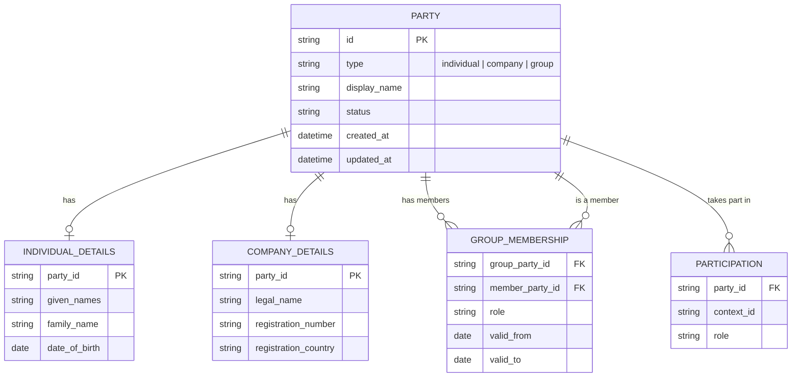

# Party — Product Requirements Document

Status: draft for review. Owner: Solution Architecture. Date: 2026-11-03.

## Summary

Party is a reusable, authoritative record for a person, a company, or a group made up
of people and/or companies. Other business processes can refer to a Party rather than
creating their own disconnected copy of a client, counterparty, or related entity.

A group is itself a Party. It represents a business-relevant collection of people
and/or companies, such as joint purchasers, a family, a corporate group, or a group of
beneficiaries. Membership and each member's role are recorded explicitly.

The product must distinguish the identity of a Party from its participation in a
matter or process. A Party may be reused in many contexts; its context-specific role
belongs to the relationship or process, not to the Party's identity.

## Problem

Business processes need to record individuals, companies, and arrangements involving
more than one of either. If each process models these independently, the same person
or company can be duplicated, group membership is difficult to represent, and
downstream processes cannot reliably tell who a record represents.

The existing CDD/KYC domain model describes a `Subject` as a person or company. It
does not yet define a reusable Party concept or a group that can be assessed as one
participant while retaining its constituent members.

## Goals

- Represent an individual, a company, or a group of individuals and/or companies
  consistently.
- Make a Party reusable across matters and business processes.
- Preserve the identity and details of group members while allowing the group itself
  to be referenced as a participant.
- Record membership, roles, and changes with clear attribution and history.
- Protect personal and commercially sensitive information through access control,
  minimisation, and auditability.
- Give downstream systems a stable identifier and a clear way to determine the Party
  type and its members.

## Non-goals

- Performing identity verification, AML screening, or making compliance decisions.
- Replacing matter, customer, CRM, or case-management systems.
- Defining the legal meaning or authority of a group; processes remain responsible for
  validating that a group can act in a particular capacity.
- Automatically merging records based only on approximate name matches.
- Modeling arbitrary nested groups in the MVP. Whether a group can contain another
  group remains an open question.

## Users and responsibilities

| User | Need |
|---|---|
| Case handler / adviser | Find or create the right person, company, or group and record its role in a matter. |
| Operations | Correct Party details and membership while preserving an audit history. |
| Compliance reviewer | Understand who was assessed, including the constituents of a group. |
| Integrating systems | Create or reference Parties reliably without duplicating identity data. |
| Administrator / privacy officer | Control access to sensitive data and support retention and correction obligations. |

## Core concepts

| Concept | Meaning |
|---|---|
| **Party** | A stable, reusable business identity. Every Party has exactly one type: `individual`, `company`, or `group`. |
| **Individual** | A natural person represented as a Party; see [[individual-model|Individual Party — Domain Model]]. |
| **Company** | A legally or commercially recognized organization represented as a Party; see [[company-model|Company Party — Domain Model]]. |
| **Group** | A Party composed of one or more member Parties. In the MVP, its members are individuals and/or companies. |
| **Membership** | A time-aware relationship between a group Party and a member Party, optionally describing the member's role in that group. |
| **Participation** | A relationship between a Party and a matter or process. It carries context-specific roles, such as purchaser or director, without changing the Party's identity. |

The diagram is conceptual. The implementation may store subtype details differently,
provided the Party type, membership, and identity boundaries remain explicit.

## User journeys

### Create or find a Party

1. A user or integrating system searches for an existing Party using available
   identifiers and descriptive details.
2. Potential matches are shown with enough information to distinguish them, subject
   to the user's access permissions.
3. The caller either selects an existing Party or creates a new Party of the correct
   type.
4. The system assigns a stable Party identifier and records the creation event.

An uncertain match must be presented for review; the system must not silently merge
records.

### Create a group Party

1. The user creates a Party with type `group` and a meaningful display name.
2. The user adds one or more existing or newly created individual/company Parties as
   members.
3. The user may record each member's group-specific role and membership dates.
4. The resulting group Party can be referenced in a matter or process, while its
   members remain independently addressable.

### Update Party or membership details

1. An authorized user changes Party details or group membership.
2. The system records who made the change, when it happened, and the fields or
   membership affected.
3. Historical participation and decisions remain interpretable against the Party
   details and membership that applied at the relevant time.

## Functional requirements

Priority: **Must** (required for MVP), **Should** (important but deferrable),
**Could** (future enhancement).

### Identity and lifecycle

| ID | Pri | Requirement |
|---|---|---|
| PRT-1 | Must | Every Party has a stable, unique identifier and exactly one type: individual, company, or group. |
| PRT-2 | Must | A Party can be created, retrieved, searched, and updated by authorized users or systems. |
| PRT-3 | Must | An individual Party supports a display name and structured person details; a company Party supports a legal name and available registration details. |
| PRT-4 | Must | A group Party has a display name and at least one member before it is used in a business process. |
| PRT-5 | Must | A group can contain both individual and company Parties. The same member may belong to more than one group. |
| PRT-6 | Must | A Party used by a matter or process is referenced by its stable identifier; context-specific roles are recorded on the participation, not as intrinsic Party attributes. |
| PRT-7 | Must | Party type cannot be changed in place. Correcting a wrongly typed record requires a controlled replacement or correction process that preserves references and history. |
| PRT-8 | Must | A Party can be marked inactive or archived without deleting its historical references. |
| PRT-9 | Should | Search supports identifiers and names, with type and status filters. |
| PRT-10 | Should | Search can surface likely duplicates but does not automatically merge them. |

### Group membership

| ID | Pri | Requirement |
|---|---|---|
| GRP-1 | Must | Each membership links one group Party to one individual or company Party. |
| GRP-2 | Must | Membership can include an optional role and effective start/end dates. |
| GRP-3 | Must | Membership changes are auditable; ending a membership does not erase its history. |
| GRP-4 | Must | A group cannot be its own member, and duplicate active membership links are rejected. |
| GRP-5 | Must | A group cannot be used in a process if it has no active members; the user receives a clear validation error. |
| GRP-6 | Should | The system can show the current and historical members of a group, including membership dates and roles. |
| GRP-7 | Could | Support nested groups, subject to agreed rules for cycle prevention, effective membership, and whether nested members count as direct or indirect members. |

### Access, privacy, and audit

| ID | Pri | Requirement |
|---|---|---|
| SEC-1 | Must | Store only details needed for an approved business purpose; protect sensitive personal and company information in storage and transit. |
| SEC-2 | Must | Access to and changes of sensitive Party data are authorized and auditable. |
| SEC-3 | Must | Every create, update, membership change, archive, and merge/correction action records actor, time, and affected Party. |
| SEC-4 | Must | Deactivation or correction does not silently alter historical matter or process records. |
| SEC-5 | Must | Retention, correction, and anonymisation follow the applicable data-protection and records-retention policy. |
| SEC-6 | Should | Access can be scoped by organization and business role, with sensitive fields restricted where required. |

### Integration

| ID | Pri | Requirement |
|---|---|---|
| INT-1 | Must | Integrating systems can create a Party or reference an existing Party by stable identifier. |
| INT-2 | Must | A Party response identifies its type and provides the appropriate identity details; a group response identifies its members and membership roles/dates. |
| INT-3 | Must | Invalid Party types, malformed identity details, invalid group membership, and unauthorized access return explicit errors rather than success-shaped defaults. |
| INT-4 | Should | Create requests support an idempotency key so retries do not create duplicate Parties. |
| INT-5 | Should | The Party service exposes enough information for downstream processes to identify whether a Party is an individual, company, or group and to resolve its members. |

## Data principles

- Identity and process participation are separate: being a purchaser on one matter does
  not make someone a purchaser on every matter.
- A group and its members are distinct Parties. Creating or updating the group does not
  overwrite the identity record of a member.
- Membership is a relationship with a history, not a copied list of names.
- Names are useful for display and search but are not reliable unique identifiers.
- Do not infer legal authority, beneficial ownership, or control solely from group
  membership or a free-text role.
- Store optional identity attributes only when justified by a consuming process.

## Success measures

| Measure | Target |
|---|---|
| Parties created with an explicit type | 100% |
| Group Parties used in a process with at least one active member | 100% |
| Party and membership changes with an attributable audit event | 100% |
| Duplicate Party creation caused by retried requests with idempotency enabled | 0 |
| Historical process records changed by Party updates | 0 |
| Unreviewed ambiguous match automatically merged | 0 |

## MVP scope

The MVP includes:

- Individual, company, and group Party types.
- Creation, retrieval, update, search, and inactive/archive status.
- Groups containing one or more individual and/or company Parties.
- Optional member roles and effective membership dates.
- Stable identifiers, validation, authorization, and auditable changes.
- Downstream reference to a Party without copying its identity as a new record.

The MVP does not include nested groups, automatic record merging, legal ownership
inference, or compliance decisioning.

## Dependencies and open questions

1. **CDD alignment:** Should Party become the canonical identity model replacing the
   current `Subject` (person/company), or should CDD retain a separate Subject that
   references Party? The domain contract must be agreed before integration.
2. **Nested groups:** Can a group contain another group, or are groups limited to
   direct individual/company members? The MVP assumes direct members only.
3. **Group meaning:** Are groups only a convenient way to represent joint parties, or
   must the model distinguish legal entities, households, beneficial ownership groups,
   and other group kinds?
4. **Group participation:** When a group is used in a process, must every member
   automatically participate, or does the caller select the relevant members?
5. **Membership validation:** Which membership roles and evidence are required for
   specific processes, and who is responsible for validating authority?
6. **Ownership and tenancy:** Is Party shared globally, or scoped to an organization
   with controlled cross-organization reuse?
7. **Matching and merge:** Which identifiers are authoritative for matching people
   and companies, and who can approve a merge or identity correction?
8. **Data policy:** What are the approved retention periods, lawful basis, and
   anonymisation requirements for each Party type and process?

## Acceptance criteria

- A user can create an individual Party, a company Party, and a group Party.
- A group can include at least one individual and one company at the same time.
- A group is addressable as one Party and its members are individually addressable.
- Group membership can be added, ended, and inspected historically without deleting
  its audit history.
- A downstream matter can reference a Party and assign a matter-specific role without
  changing the Party's identity or role in another matter.
- Invalid self-membership, duplicate active membership, and use of an empty group are
  rejected with actionable errors.
- Updating or deactivating a Party does not rewrite prior participation or decision
  history.
- Unauthorized readers cannot retrieve protected Party details, and sensitive access
  is auditable.
