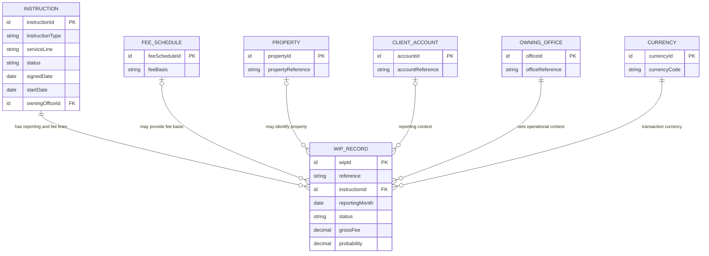

# European Property WIP Entity

Status: draft, based on the newer shared finance-table definition.
Related: [[euro-property-transaction-wip-process]] describes the lifecycle and operating
rules.

## What the entity represents

A **WIP record** represents one fee-bearing unit of authorized property transaction
work for one reporting period. It holds the financial forecast and, later, the
invoice/payment facts for that unit of work.

It is a child of an **instruction** (the authorized engagement record), not a copy of
the whole transaction or deal. One instruction can have many WIP records—for example,
separate fee components, properties, or recurring reporting periods. The WIP record
keeps selected instruction context alongside its own financial and lifecycle data so
finance can report without reconstructing every relationship.

## Relationship view



The optional links shown are logical links from the source model. The exact cardinality
and mandatory rules for every lookup should be confirmed against the final implementation
schema.

## Logical record shape

The following is a readable, organization-neutral view of a WIP record. It is not a
literal API payload or finalized database schema.

```yaml
wipRecord:
  identity:
    id: required
    reference: generated
    instructionId: required
    feeScheduleId: optional

  reportingContext:
    serviceLine: inherited
    transactionType: inherited
    sector: inherited
    clientAccountId: inherited
    entityAccountId: optional
    propertyId: optional
    leadNegotiatorId: inherited
    owningOfficeId: inherited
    currency: inherited

  financials:
    grossFee: amount
    netFee: amount
    officeRetainedFee: amount
    probability: percentage
    weightedOfficeRetainedFee: calculated
    taxRate: percentage

  period:
    reportingMonth: required, first day of month
    expectedCompletionMonth: optional
    staleDate: calculated
    isStale: calculated

  lifecycle:
    status: required
    statusChangedAt: automatic
    previousProbability: automatic

  billing:
    invoiceNumber: required at Billed and Paid
    invoiceDueDate: required at Billed
    paidInFullDate: required at Paid
    financeSystemReference: required at Billed in the business rules

  periodControl:
    isPeriodLocked: automatic
    lockedAt: optional
    lockedBy: optional
    comments: optional
```

## Attribute groups

| Group | What the record holds |
|---|---|
| Identity and parent | A unique record ID, generated human-readable reference, required parent instruction, and optional fee-schedule link. |
| Reporting context | Service line, transaction type, sector, client account, lead negotiator, owning office, currency, and optional property/entity references. Some values are copied from or inherited from the instruction to support reporting. |
| Financials | Gross fee, net fee, office-retained fee, probability, tax rate, and calculated weighted office-retained fee. The weighted value is `office-retained fee × probability / 100`. |
| Period and aging | Required reporting month (stored as the first day of the month), expected completion month, and calculated stale date/flag. The stale date is expected completion plus 30 days; a record is stale when it remains WIP after that date. |
| Lifecycle | One of `WIP`, `Billed`, `Paid`, or `Lost`, plus status-change time and previous-probability tracking. |
| Billing | Invoice number, due date, date paid in full, and finance-system cross-reference, conditionally required by status. |
| Period control | Period-lock flag, lock time, locking user, and comments. The exact locked field set and unlock authority remain undecided. |

## Lifecycle on the entity

```text
                 ┌──────────────► Lost
                 │
WIP ─────────► Billed ─────────► Paid

```

- **WIP** — fees are forecast and updated for the reporting period.
- **Billed** — invoice has been issued; billing fields must be populated.
- **Paid** — payment is received in full; payment date is recorded.
- **Lost** — work is abandoned, the parent instruction is withdrawn, or an issued
  invoice is cancelled.

`Paid` and `Lost` are terminal in the documented lifecycle. The source does not define
a transition from `Paid` to `Lost`.

## Important modeling rules

- The parent instruction is the WIP record's single service-line path. Service-line
  deals or engagements relate indirectly through the instruction; the current core
  design does not put separate service-line parent lookups on each WIP record.
- Creating the WIP record depends on the instruction already existing, because some
  reporting context is inherited from it.
- The instruction can have many WIP records. Separate reporting months or fee components
  should not be collapsed into one mutable lifetime record.
- The reporting month is stored on each record, preserving period history rather than
  relying on separate monthly sheets.
- Probability is editable while the record is WIP and is locked after it leaves WIP.
- Inherited classification fields are denormalized snapshots for flat reporting. The
  source expects them to be populated from the parent when the WIP record is created.
- A possible duplicate is identified by the same parent instruction, expected
  completion month, and status; the documented control is a warning.

## Known schema conflict

The newer shared-table definition is treated as authoritative here: the WIP record has
one parent instruction and an optional fee-schedule reference. Older source material
describes multiple service-line parent links, so it should not be mixed into this model.

There is a separate unresolved billing-field conflict: business rules require a
finance-system reference at Billed, but the newer shared-table field list does not
include that reference on the WIP record. The source places finance-system details on
the parent instruction in one definition and on the WIP record in another. The owning
system and exact field location need a decision before implementation.

The required-at-Billed rules for the invoice number and due date, and required-at-Paid
rule for paid-in-full date, are stated in the source. This document does not resolve
the missing finance-reference field.

## Country-dependent context

The entity's operating process is common across the recorded countries. The source
records owning-office defaults for VAT of France 20%, Spain 21%, and the United Kingdom
20%, and says the owning office—not the client's location—selects the default.
Treat these as source-design values pending validation by Finance/tax owners, not as
authoritative current tax advice. Other country-specific rules have not been established.
See [[euro-property-transaction-wip-process]] for the country comparison and open
decisions.

## Source basis

This logical model is derived from the European WIP table specification, project
overview, parent-instruction model, and open-questions notes. It abstracts the source's
organization-specific table and field identifiers into business-neutral names. It is
descriptive, not a replacement for an approved physical schema.
