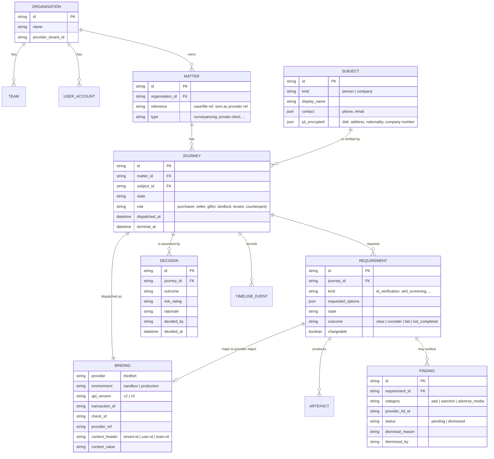

# CDD/KYC domain model

The internal vocabulary our API exposes, and how it maps onto Thirdfort's objects. The point of this layer is that our domain terms survive a provider change; Thirdfort's `transaction`/`check`/`task` words never leak to callers.

Related: [[internal-cdd-api]], [[cdd-journey-state-model]], [[thirdfort-api-notes]]

## Entities

| Entity | Meaning | Owner |
|---|---|---|
| `Organisation` | Our customer — the firm or business running CDD. Maps to a Thirdfort **tenant**. | ours |
| `Team` | Sub-grouping of users within an organisation (direct integrations use these). | ours |
| `Matter` | The engagement/file/case the CDD belongs to. Carries the human reference used for grouping and billing. | ours |
| `Subject` | The party being verified: a `Person` or a `Company`. Owns the PII we may or may not forward. | ours |
| `Journey` | One dispatch of verification work for one subject within a matter. The unit of work, cost and reporting. | ours |
| `Requirement` | One thing we asked for on a journey (ID, screening, POA, SoF, KYB, title documents, document verification, monitoring). Thirdfort calls these tasks/reports. | ours |
| `Binding` | The provider-side handle for a journey or requirement: environment, transaction/check id, context header values, provider `ref`. | ours |
| `Artefact` | Retrieved evidence: report JSON, results PDF, additional-documents ZIP, uploaded document. | ours (copied) |
| `Finding` | A normalised screening hit (PEP, sanction, adverse media) with dismiss/whitelist state. | ours |
| `Decision` | The compliance outcome and its rationale: approved, approved with notes, referred, rejected; risk rating; reviewer. Thirdfort has no equivalent. | ours |
| `Timeline Event` | Append-only audit record of anything that happened, internal or provider-driven. | ours |
| `Consent & Terms` | Evidence that the consumer consented and the firm accepted Thirdfort's terms. | ours |

## Journey shapes

A journey is 1:1 with exactly one provider container. Which container depends on what was asked for:

| Journey kind | Provider container | Endpoints |
|---|---|---|
| Individual ID / AML / SoF / POA (+ monitoring) | v2 **transaction** | `POST /v2/transactions`, `GET /v2/transactions/{id}` |
| Document verification | v2 **check** (`type: document`) | `POST /v2/checks`, `POST /v2/checks/{c}/documents` |
| Know Your Business | v2 **check** (`type: company`) | `POST /v2/checks`, `GET /v2/checks/{c}` |
| Title documents | v3 **check** (`type: title`) | `POST /v3/checks`, `GET /v3/checks/{c}` |

Because provider containers are immutable in composition, the internal rule is:

> **One dispatch = one journey.** Adding a requirement after dispatch means creating a new journey against the same matter and subject.

That is deliberate: it keeps the model honest about what Thirdfort allows (no additive tasks), and it makes later additional purchases (a SoF check a month after the ID check) explicit and separately auditable.

## Requirement kinds and their options

| Requirement kind | Thirdfort tasks | Options we expose |
|---|---|---|
| `id_verification` | `report:identity`, `report:footprint`, `report:peps` | `method: nfc_preferred \| original \| lite`, `international_address_verification: bool`, `monitoring: bool` |
| `aml_screening` | `report:screening:lite` (standalone) | `given_name`, `family_name`, `year_of_birth`, `country_iso3` |
| `address_verification` | `report:footprint` | `international_address_verification: bool` |
| `proof_of_address` | `documents:poa` | — |
| `proof_of_ownership` | `documents:poo` | — |
| `source_of_funds` | `report:bank-statement`, `report:bank-summary`, `report:sof-v1`, `documents:bank-statement` | `party_role: purchaser \| giftor`, `bank_statements: automatic \| manual \| both` |
| `company_check` (KYB) | `company:summary`, `company:sanctions`, plus optional jurisdiction-specific reports | `reports: [...]`, `monitoring: bool` |
| `title_documents` | `title:plan-*`, `title:register-*` | `title_numbers{freehold,leasehold}` or `address` |
| `document_verification` | `identity:lite` via a `document` check | `document_type`, front/back files |
| `ongoing_monitoring` | `opts.monitored` on `report:peps` / `company:sanctions` | `enable`, later `disable` |

Validation rules that belong in our layer, not the caller:

- `proof_of_ownership` only valid for transferor/borrower/lessor roles.
- `aml_screening` standalone requires DOB + last name + ISO3 country; the app-based products need only name + mobile.
- Mobile number required whenever `method` includes an app journey; validate with libphonenumber and warn for the 23 unreliable-delivery country codes.
- `international_address_verification` consent only meaningfully required for the listed non-UK countries.
- Title documents: only order titles whose availability is `IMMEDIATE`, and only within HMLR hours.
- Monitoring can never be enabled after creation if it was created disabled.

## Normalised outcomes

Two orthogonal fields, mirroring the provider but with clearer names:

- `requirement.state` — `requested`, `in_progress`, `completed`, `not_completed`, `cancelled`. Derived from the provider report status where `closed`/`complete` ⇒ `completed`, and `error`/`expired`/`rejected`/`unobtainable` ⇒ `not_completed`.
- `requirement.outcome` — `clear`, `consider`, `fail`, or `null` while incomplete.

Journey-level roll-up (see [[cdd-journey-state-model]] for the state machine) is ours alone: the provider never says "approved".

## Identity of the subject

- We are the system of record for subject PII. Thirdfort receives only what a check requires — name + mobile for app journeys, plus DOB/address for screening, plus document images for verification.
- We should store the minimum and mark the rest as derived: after completion, the authoritative record is the provider report/PDF, which we copy into our own store (Artefact) so we are not permanently dependent on provider availability.
- Retention is set by our own AML obligations (5 years from the end of the relationship) and not by Thirdfort's tenancy.

## What we deliberately do not model

- Thirdfort teams and stub users as first-class internal concepts. They are `Binding.context_*` values created and cached by the integration layer.
- Thirdfort's `print`, `ce`, `gid`, `uid` metadata. Stored on the binding for support purposes, never surfaced in our API responses.
- Provider versioning (`v2`/`v3`). It is a property of the binding, invisible to callers.
