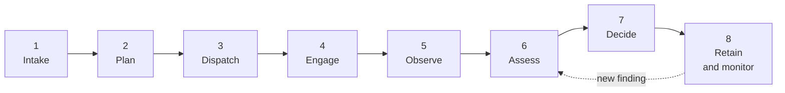

# Internal CDD process — PRD

What we are building, for whom, and what "done" means: one internal process for running
customer due diligence across the firm, with Thirdfort as the verification provider behind
it. This is the requirements counterpart to the design in [[internal-cdd-api]]; the API is
the mechanism, the process is the product.

Status: draft for review. Owner: Solution Architecture. Date: 2026-10-15.

Related: [[internal-cdd-api]], [[cdd-kyc-domain-model]], [[cdd-journey-state-model]],
[[thirdfort-api-notes]], [[internal-cdd-api-openapi.yaml]], [[cdd-poc-app]]

## Summary

CDD work today is arranged around a provider's verification toolkit: transactions, checks,
tasks and reports. That shape does not match how the firm actually works a matter, and it
puts the compliance decision nowhere at all — Thirdfort returns evidence and a result flag
and stops.

We are building one internal process that owns the whole arc: **plan what is required of a
subject, dispatch it, chase it, watch it, assess the evidence, record the decision, keep the
record, and keep watching afterwards.** The provider becomes an implementation detail behind
that process.

Concretely, this means an internal API and service layer in our own vocabulary — `Matter`,
`Subject`, `Journey`, `Requirement`, `Finding`, `Decision` — that internal systems and
advisers call instead of integrating Thirdfort directly. Which is the thing every team would
otherwise rebuild, separately and worse.

## Problem

Three distinct failures, one cause.

1. **The vocabulary is the provider's.** Our systems think in matters, clients and files.
   Thirdfort thinks in transactions, checks and tasks. Every integration therefore begins
   with a translation layer, and each one translates differently.
2. **The truth is buried.** Whether an ID check completed, *which* method actually completed,
   whether Source of Funds completed at all, and what is chargeable are all only recoverable
   by reading nested report payloads. An Enhanced NFC check can silently degrade to an
   Original ID. A `transaction: closed` means the PDF is ready, not that the client passed.
3. **Nobody owns the decision.** The provider has no concept of a compliance decision, a
   reviewer, or an approval. So the decision — the point of the exercise — lives in
   spreadsheets, inboxes and individual memory, or is implicitly inferred from a provider
   status that does not mean what it appears to mean.

Add the reliability gap: Thirdfort documents no idempotency, no retry, no ordering guarantee,
no rate-limit contract and no replay. Every team building directly inherits all of it.

## Goals

- **One process, one record.** A matter's CDD is run and evidenced in one place, from plan to
  decision to retention, with an append-only audit trail.
- **The decision is explicit and owned.** A named reviewer records an outcome, a risk rating
  and a rationale. Terminal states are earned, never inferred from a provider status.
- **Derived truth is delivered, not computed by callers.** One summary call answers "where is
  this, what is outstanding, what evidence do we hold, what is chargeable".
- **The provider is replaceable, and invisible.** Callers never name a transaction, a check,
  a task, a report, or an API version.
- **Failure is absorbed, not passed on.** Duplicate dispatches, dropped webhooks, out-of-order
  events, provider outages and slow document generation are handled by the layer.

### Success measures

| Measure | Target |
|---|---|
| Journeys dispatched without an engineering ticket per new product | all supported kinds |
| Journeys with a recorded decision and reviewer | 100% |
| Reports-of-record held internally at end of relationship | 100% |
| Duplicate journeys created by a retried dispatch | 0 |
| Journeys stuck in a non-terminal state beyond threshold | < 2%, and all explained on the timeline |
| Chargeability derived from provider payloads by Finance | 0 |

## Non-goals

- **A provider-agnostic abstraction for its own sake.** We abstract Thirdfort's *model*, not
  its features. A second provider is a repository rewrite behind the same domain, and that
  is enough.
- **Consumer-facing UI.** The subject uses the Thirdfort app. We trigger and observe.
- **Exposing raw provider payloads or live provider URLs.** No passthrough endpoints. The one
  escape hatch returns bytes we stored ourselves.
- **Replacing the firm's case management.** We hold CDD, not the matter.
- **Being system of record for the subject's document custody beyond what regulation requires.**

## Users and roles

| Role | Needs |
|---|---|
| **Case handler / adviser** | Plan requirements for a subject, send it, see progress, chase, know what is blocking, hand off for decision. |
| **Compliance reviewer / MLRO** | The evidence in one place, findings in context, a decision to record, and an audit trail that survives scrutiny. The authority to approve, refer or reject. |
| **Ops / QC** | Find stuck journeys, resend invites, correct contact details, replay events, reconcile divergence between our state and the provider's. |
| **Origination / case systems** | Open a matter and request CDD without understanding verification. Machine-to-machine, idempotent, non-blocking. |
| **Risk & reporting** | Findings across the book, cycle times, chargeability. |
| **Finance** | Which requirements are chargeable, per matter, without re-deriving it from report payloads. |

## The process

| # | Phase | Who | Entry → Exit | Failure modes the process must handle |
|---|---|---|---|---|
| 1 | **Intake** | Case handler, origination | Matter opened, subject captured → subject contactable and sufficiently described | Duplicate subject records; missing mobile or DOB; unreliable-destination phone numbers |
| 2 | **Plan** | Case handler | Requirements chosen → plan validated against role and provider constraints | Incompatible role/requirement pair; title unorderable or out of HMLR hours; a requirement added after dispatch |
| 3 | **Dispatch** | Case handler, origination system | Plan accepted → provider container created, invite issued | Retried dispatch; provider outage; latency beyond budget |
| 4 | **Engage** | Subject (Thirdfort app) | Invite delivered → subject completes tasks | Undelivered invite; wrong contact details; subject never starts; subject starts and abandons |
| 5 | **Observe** | The layer | Provider progresses → state and outcomes derived | Duplicate, out-of-order or dropped events; slow v3 document generation; provider errors |
| 6 | **Assess** | Compliance reviewer, ops | Requirements terminal → evidence and findings understood | Findings pending; report `error`/`expired`/`unobtainable` misread as a failed subject; a monitored hit arriving after the decision |
| 7 | **Decide** | Compliance reviewer / MLRO | Assessment done → decision recorded, journey closed | Decision attempted against a cancelled or abandoned journey; a re-decision overwriting history |
| 8 | **Retain & monitor** | The layer, compliance | Journey closed → evidence retained, monitoring continues | Artefacts unavailable from provider later; renewal silently lapsing; a post-decision hit with no route to reconsider |

Journey-level states and the provider signals that drive them are in
[[cdd-journey-state-model]]; the units involved are in [[cdd-kyc-domain-model]].

## Functional requirements

Priority: **Must** (MVP cannot ship without it), **Should** (expected, deferrable once),
**Could** (nice to have).

### Intake — the matter and the subject

| ID | Pri | Requirement |
|---|---|---|
| SET-1 | Must | Every journey belongs to exactly one matter, and the matter reference travels upstream as the provider `ref`. |
| SET-2 | Must | A subject is a person or a company, created once and reusable across journeys and matters. |
| SET-3 | Must | A valid, contactable mobile number is required before any app-based requirement is planned; validate with libphonenumber and warn on the known unreliable-delivery country codes. |
| SET-4 | Must | Date of birth, family name and ISO3 country are required before standalone screening. |
| SET-5 | Must | Subject PII is stored encrypted on a minimum-necessary basis; reading it requires an explicit scope and every read is audited. |
| SET-6 | Should | Subject records de-duplicate on name plus date of birth or company number, so a returning client does not become two people. |

### Plan — what we are asking for

| ID | Pri | Requirement |
|---|---|---|
| PLN-1 | Must | Callers express obligations in our vocabulary (requirement kinds). Provider task names and container types are never part of the caller's request. |
| PLN-2 | Must | Role/requirement compatibility is validated before dispatch — for example proof of ownership is valid only for transferor, borrower and lessor roles. |
| PLN-3 | Must | Requirements are fixed at dispatch. There is no endpoint to add one to a live journey; adding work means a new journey for the same matter and subject. |
| PLN-4 | Must | Title requirements are orderable only when availability is `IMMEDIATE` and only inside HMLR hours (06:30–23:00 GMT, workdays). The constraint is surfaced before the attempt, not returned as an error from it. |
| PLN-5 | Should | Before dispatch, the caller can preview what will be ordered and an indicative chargeability and count. |
| PLN-6 | Should | A retried or duplicated dispatch intent cannot produce two journeys. |

### Dispatch

| ID | Pri | Requirement |
|---|---|---|
| DSP-1 | Must | One call dispatches a journey carrying one or more requirements, and returns a journey identifier and its initial state. |
| DSP-2 | Must | Dispatch is idempotent under a caller-supplied key. Same key and same body returns the original response; same key and a different body is refused with `409`. |
| DSP-3 | Must | Provider container selection (v2 transaction, v2 check, v3 check) is internal. The caller neither sees nor chooses it. |
| DSP-4 | Must | Provider unavailability never produces a partial journey. The dispatch either succeeds whole or does not happen. |
| DSP-5 | Should | When provider dispatch exceeds the latency budget, the call returns `202` with a journey id rather than blocking the caller. |

### Engage — getting the subject through it

| ID | Pri | Requirement |
|---|---|---|
| ENG-1 | Must | Invite issuance is tracked as issued / delivered / undelivered, and is visible on the journey. |
| ENG-2 | Must | An invite can be re-issued on demand. This is our capability; the provider has no resend endpoint. |
| ENG-3 | Should | An undelivered invite raises an alert within the SLO window so ops can correct the contact details. |
| ENG-4 | Should | Journeys expose time-in-state so ops can chase, and every chase attempt is recorded on the timeline. |

### Observe — deriving the truth

| ID | Pri | Requirement |
|---|---|---|
| OBS-1 | Must | Journey and requirement state is computed from a re-read of the provider resource, never from a webhook body. Duplicate events are no-ops; out-of-order events can only move state forwards. |
| OBS-2 | Must | A reconciler re-reads every non-terminal journey on a decaying schedule, covering missed events. |
| OBS-3 | Must | A polling-inbox fallback covers the case where our webhook endpoint is unavailable; messages are de-duplicated and acknowledged only after a successful reconcile. |
| OBS-4 | Must | The identity method that *actually completed* is reported. An Enhanced NFC journey that degraded to an Original ID is `Original`, not `Enhanced NFC`. |
| OBS-5 | Must | `not_completed` is never presented or reported as a failure of the subject. A skipped Source of Funds task is not-completed, not failed. |
| OBS-6 | Must | One reviewer-facing summary states current state, per-requirement outcome, outstanding findings, blockers and chargeability, without the caller understanding any report payload. |
| OBS-7 | Must | A provider `400` during v3 document generation is classified as upstream-not-ready and retried with backoff. It is never surfaced as a validation error. |

### Findings — screening hits

| ID | Pri | Requirement |
|---|---|---|
| FND-1 | Must | Screening hits (PEP, sanction, adverse media) are normalised into findings with a pending/dismissed state, independent of the provider's own hit model. |
| FND-2 | Must | A finding can be dismissed or whitelisted with a reason, attributed to the actor who did it. |
| FND-3 | Must | A change in the hit set on a monitored requirement raises new findings and requires an explicit re-decision. State never moves silently as a result. |

### Decide

| ID | Pri | Requirement |
|---|---|---|
| DEC-1 | Must | A human decision is recorded against the journey with an outcome, a risk rating, a rationale and a named reviewer. |
| DEC-2 | Must | A journey reaches `awaiting_decision` only when every requirement has reached a terminal provider status. |
| DEC-3 | Must | `closed` means a decision exists. It is never inferred from a provider status — a provider `closed` means the PDF is ready. |
| DEC-4 | Must | A re-decision is a new immutable record that supersedes the previous one. Decision history is never rewritten. |
| DEC-5 | Must | A decision against a cancelled or abandoned journey is refused. |
| DEC-6 | Should | A decision cannot be recorded while findings are pending without an explicit acknowledgement, so the guard is visible rather than implicit. |

### Monitor

| ID | Pri | Requirement |
|---|---|---|
| MON-1 | Must | Monitoring is a flag on the journey, not a state. It can outlive `closed`, because a monitored check can produce a new report version months later. |
| MON-2 | Must | Monitoring cannot be enabled after creation if it was created disabled. |
| MON-3 | Must | Monitoring can be disabled on demand. Aborting a journey disables it automatically. |
| MON-4 | Must | Monitoring renewal is warned at least 21 days ahead. |
| MON-5 | Must | A post-decision hit raises a finding and a timeline event. It never silently moves a closed journey's state. |

### Retain and audit

| ID | Pri | Requirement |
|---|---|---|
| AUD-1 | Must | An append-only timeline records everything that happened, internal or provider-driven. Divergence between our state and the provider's is recorded, not smoothed over. |
| AUD-2 | Must | The provider's authoritative artefacts (report JSON, results PDF, additional-documents ZIP, uploaded documents) are copied into our own store, so the report of record does not depend on continued provider availability. |
| AUD-3 | Must | Provider bytes are served from our store. Callers never receive a live provider URL. |
| AUD-4 | Must | Records are retained for the regulated period (currently 5 years from the end of the relationship) and anonymised rather than deleted by caller action. |
| AUD-5 | Must | Evidence of consumer consent and of the firm's acceptance of provider terms is captured and filed with the matter. |
| AUD-6 | Must | Cancellation is available at any non-terminal point. It is irreversible, and the process says so at the point of use. |

### Bill and report

| ID | Pri | Requirement |
|---|---|---|
| BIL-1 | Must | Chargeability is derived per requirement: ID per completed check, Source of Funds per property transaction grouped by identical `ref`, international address verification not chargeable where the address country is `GBR`. |
| BIL-2 | Must | The provider `ref` format is canonical and stable, so chargeability grouping is deterministic. |
| BIL-3 | Should | Chargeability is exposed on the requirement so Finance does not re-derive it from payloads. |
| MI-1 | Must | Findings are queryable across journeys by status, category and date. |
| MI-2 | Should | Cycle time and completion rate are reportable by requirement kind, to show where subjects stall. |
| MI-3 | Should | Chargeability rolls up per matter and per organisation. |

## Non-functional requirements

| Concern | Requirement |
|---|---|
| Dispatch latency | p95 under 1.5 s including provider dispatch; otherwise queue and return `202` with a journey id. |
| Read latency | p95 under 300 ms from our store. No live provider call on a read path except an explicit refresh. |
| Decision write | Synchronous, durable and audited before it is acknowledged. |
| Webhook receiver | Acknowledges in under 100 ms; processing is asynchronous. |
| Reconciliation | Minutes while a journey is young, decaying to hours after 24 h. |
| Environment isolation | Sandbox and production are never mixed. A journey is pinned to one for its lifetime. |
| Audit durability | The timeline is append-only. No rewrite, no retro-edit, no backfill that hides history. |
| Security | OAuth2 client credentials, one client per system, scopes as the permission model. |
| Encryption | PII fields and artefacts encrypted at rest. |
| Testability | The contract is executable: a mock implementation of the API runs the whole process without a backend, as in [[cdd-poc-app]]. |

## Compliance requirements

The process exists to satisfy CDD obligations, so these are requirements, not commentary.
**The specific regulatory citations below are assumptions to be confirmed with Compliance
before build** — they are recorded here so the confirmation is explicit rather than implied.

- Customer due diligence and enhanced due diligence must be evidenced per subject before the
  relationship proceeds, and the evidence retained for the regulated period (currently
  5 years from the end of the relationship).
- PEP, sanctions and adverse media screening must be performed, and hits must be assessed and
  dispositions recorded with a reason.
- Ongoing monitoring must continue for the appropriate period, and a post-decision hit must
  have a route back to a fresh assessment.
- A named individual must own each decision, with the rationale recorded.
- Source of funds must be evidenced for the relevant property transactions, and the evidence
  must survive independently of the provider.
- Consent from the subject for their identity data to be processed must be captured.

Where regulation and the provider disagree — most visibly, where the provider says "closed"
and the process still requires a human judgement — the process follows the regulation and
the provider status is treated as an input, never an outcome.

## Where this is specified today

| This PRD | Design detail |
|---|---|
| Phases, roles | [[cdd-kyc-domain-model]], [[cdd-journey-state-model]] |
| SET, PLN, DSP, ENG, FND, MON | [[internal-cdd-api]] §Endpoint surface, §Request envelope and validation |
| OBS | [[cdd-journey-state-model]] §Provider signal → internal transition, plus §Failure modes |
| AUD, BIL | [[internal-cdd-api]] §PII, retention and audit |
| Contract | [[internal-cdd-api-openapi.yaml]] |
| Upstream facts and constraints | [[thirdfort-api-notes]] |
| Executable reference | [[cdd-poc-app]] |

## Release phasing

| Phase | Contents | Exit |
|---|---|---|
| **0 — POC** | The whole process simulated against a mock provider. Done — see [[cdd-poc-app]]. | The vocabulary holds and the contract is executable. |
| **1 — MVP** | Intake, plan, dispatch, observe, decide, retain. Identity and screening journeys (v2 transaction), artefacts, audit, decisions. | One real journey per subject, decided and evidenced, with no engineering involvement per case. |
| **2 — Depth** | Source of funds, proof of address and ownership, document verification, monitoring and findings, chargeability derivation, ops console. | The common conveyancing journey runs end to end. |
| **3 — Breadth** | KYB, title documents (v3), post-decision re-assessment, MI, subject reuse. | The process covers the firm's matter types without exception handling by hand. |

## Assumptions

- The firm is a Thirdfort reseller, so chargeability derivation is required to bill. If that
  changes, BIL-1 to BIL-3 become reporting-only.
- Thirdfort remains the sole provider for phase 1. The domain is designed so a second provider
  is a repository rewrite, not a domain change.
- Provider tenant and stub-user mapping is established once per customer and cached.
- 5 years from end of relationship remains the retention period. See Compliance above.
- The subject's own experience happens in the Thirdfort app and is not ours to design. If
  that assumption breaks, ENG-1 to ENG-4 stop being sufficient.

## Risks

| Risk | Impact | Mitigation |
|---|---|---|
| Provider key rotation is undocumented, and v3 documents no audience | Blocks production auth | One integrator per environment until answered; treat the token minter as a single point of failure and instrument it |
| Upstream rate limits are undocumented | Sandbox surprises, throttling in production | Self-imposed global cap and queue; measure empirically before load |
| Monitoring semantics across a closed journey are unresolved | Post-decision hits could be mishandled | Current design raises a finding and requires re-decision; never moves state silently |
| Provider changes the report payload shape | Derived truth silently wrong | Reconcile from the resource, pin and test the derivation against fixtures, alert on unknown report types |
| Title availability and HMLR hours constrain the process | Journeys stall out of hours | Surface the window pre-emptively rather than failing at dispatch |

## Open questions

Carried over from [[internal-cdd-api]], plus the ones this PRD exposes.

- **Monitoring across a decision.** Re-open the journey, raise a new one, or add a finding and
  require an explicit re-decision? Current design is the third.
- **Multi-matter subjects.** Reuse prior artefacts for a person verified on another matter, or
  force a fresh journey for evidential cleanliness? Leaning to a fresh journey referencing
  the prior one.
- **`ref` format.** What is the canonical internal format, and is it stable enough to group
  chargeability by?
- **Rate limits and key rotation.** Both undocumented upstream.
- **Who may decide.** Is the decision scope limited to a compliance role, or does a senior
  case handler hold it for low-risk matters? This changes DEC-1 and the RBAC model.
- **EDD triggers.** Which findings and risk ratings force enhanced due diligence, and is that
  expressed in the process or left to the reviewer's judgement?
- **Retention start point.** "End of relationship" needs a precise definition and the process
  needs a field to hold it.

## Acceptance criteria

The process is done when, for a real matter and subject:

1. CDD is planned, dispatched and completed through the internal API alone, with no one
   touching Thirdfort directly.
2. Every requirement's outcome, and the identity method actually completed, is correct
   without reading a provider payload.
3. A not-completed requirement is reported as not-completed, and the reviewer sees why.
4. A named reviewer records a decision with a rationale, and the journey is closed by that
   act and no other.
5. An auditor can reconstruct the whole history — who asked for what, when, and on what
   evidence — from the timeline and stored artefacts, without provider access.
6. Finance can derive what to charge without recomputing it from payloads.
7. Killing our webhook endpoint mid-flight changes nothing about the eventual outcome.
